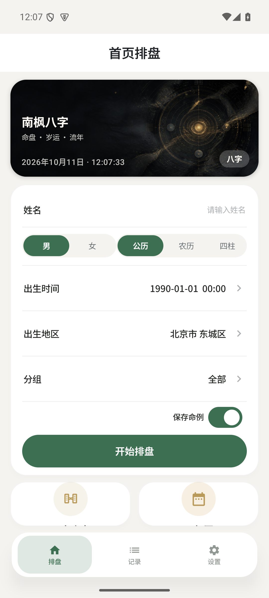
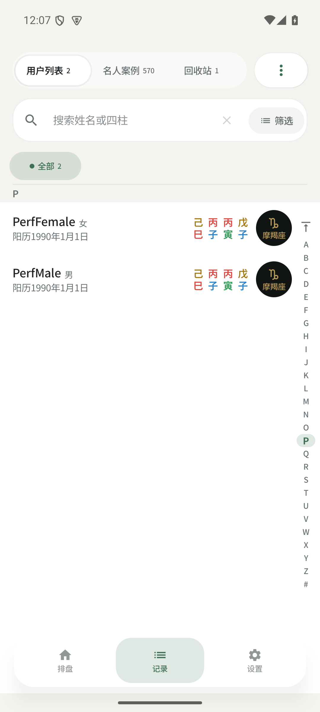
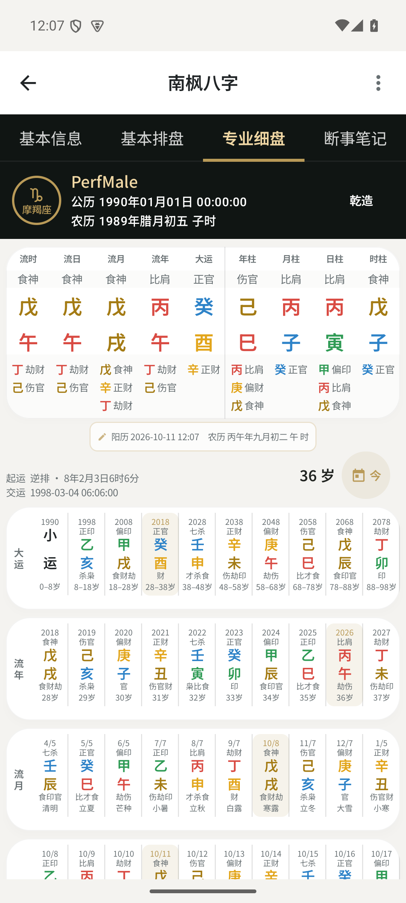

# 南枫八字 · Android

本地优先的 Android 八字排盘与命例研究工具。

[下载 Android 正式版](https://github.com/nanzhufeng/NanfengBazi-Android/releases/latest)

## 软件预览

以下预览来自 v1.0.16 Release 安装包的 API 35 模拟器运行页面（1080 × 2400），使用合成演示资料。

<p align="center">
  
  
  
</p>

## 核心功能

- 离线排盘：公历、农历、四柱、时区与真太阳时口径。
- 命例管理：分组、标签、笔记、关键事件、筛选与回收站。
- 万年历：公农历、节气、日柱与用此日期排盘。
- 问真截图整理：识别结果可核对、可修改后再保存。

命例与资料默认保存在本机；云备份和 AI 点评均为可选功能。

## 开发

使用 Android Studio 自带的 JBR 运行本地门禁：

```bash
./gradlew test assembleDebug lintDebug
```
